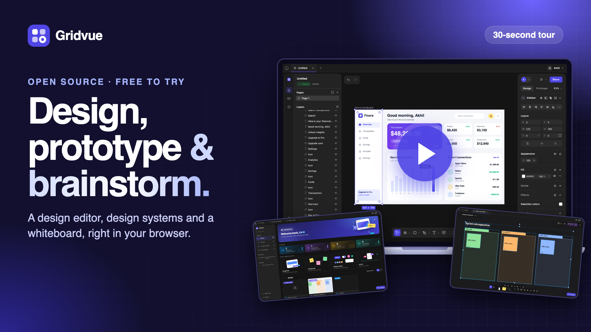

# Gridvue

An open-source, browser-based design tool: a **design editor**, a **FigJam-style whiteboard**, **design systems** and **prototyping** in one workspace. It runs entirely on your own machine: a small Node server plus a React web app, with files stored in a local SQLite database.

> **Status: early / for testing.** Sign-in only asks for a name (no password). Use it locally or share a link only with people you trust. See [Known limitations](KNOWN_LIMITATIONS.md).

<p align="center">
  <a href="docs/video/gridvue-demo-1920x1080.mp4" title="Watch the 30-second demo">
    
  </a>
  <br>
  <sub>▶ Click the image to watch the 30-second tour</sub>
</p>

## What's inside

- **Design editor** – frames, shapes, pen and pencil, boolean operations, masks, text with a full typography panel, auto layout, components and variants, variables and design tokens, styles, export to PNG, JPG and WebP at several scales.
- **Whiteboards inside designs** – insert a whiteboard card into a design file (shape menu → Whiteboard…). Select the card and the real whiteboard is live inside it: click, draw, add notes, zoom and drag, and resize the card like any layer. Drag items off the board onto the design to turn them into editable layers (stickies, text, shapes, drawings, connectors, tables, code blocks, link cards, stamps and timers all become real frames, text and vector layers; only photos stay images). Unselected cards show the board drawn in its own whiteboard style.
- **Prototyping** – link frames, set transitions, present on device frames, share a play link. An interaction can also **open one of your whiteboards** (Prototype tab → add interaction → action *Open whiteboard*, on click, hover or any other trigger): the player shows the board to pan and zoom, with a button to open it for editing.
- **Whiteboard** – sticky notes, shapes and connectors, text, sections, pen / marker / highlighter, stamps and emoji, tables, code blocks, images, link cards, timer, voting, comments, templates, PNG export.
- **Design systems** – reusable component libraries you can publish and use from other files.
- **Import / export** – paste layers from Figma, import `.fig`, `.xd` and native `.layr` files; export `.layr`, `.fig` and `.xd`.
- **Dashboard** – all files in one place, filter by type, projects, starred files, light and dark themes.

### Whiteboard inside a design file

Brainstorm and design in the same place:

1. Make a whiteboard (**New whiteboard** on the dashboard) and add a few notes.
2. Open a design file and choose **Whiteboard…** from the shape menu in the bottom toolbar, then pick your board (or create a new one).
3. The board appears as a card on the canvas, drawn in whiteboard style. **Select the card** and the real whiteboard is live inside it: click, add notes and shapes, draw, zoom and pan. Its toolbar follows the design's zoom. Move or resize the card like any layer.
4. **Drag items off the board onto the design** (or press *Send selection to design*). They arrive as editable design layers: stickies, text, shapes, drawings, connectors, tables, code blocks, link cards, stamps and timers become frames, text and vector paths you can restyle; photos stay image layers. The board keeps its own copy.
5. Click elsewhere to close the live board; it saves automatically and the card updates.

Limits: one card is live at a time and copies in the design are not kept in sync with the board. To link a prototype to a board, use the *Open whiteboard* action (next section). Select a frame before inserting a card and it lands inside that frame, so prototypes can include it. See [KNOWN_LIMITATIONS.md](KNOWN_LIMITATIONS.md).

### Open a whiteboard from a prototype

Link a screen to a whiteboard the same way you link screens to each other:

1. In a design file, put your screens in top-level frames (a prototype plays frames; a layer loose on the page is not a screen).
2. Open the **Prototype** tab, select the layer people will interact with (a button, a card, a whiteboard card) and press **+** next to *Interactions*.
3. Pick a trigger: *On click / tap*, *While hovering*, *Mouse enter*, *After delay*, a key press and so on.
4. Press **+ Add action**, choose **Open whiteboard**, then pick one of the whiteboards you already made.
5. Press **Present prototype**. When the trigger fires, the board opens in the player: drag to pan, wheel to zoom, **Open whiteboard** to edit it in its own tab, **Back to prototype** to carry on.

The player's top bar groups its controls with icons: Close, the flow picker, previous screen and Restart, Hotspots and Fit/100%, the device frame and Open in new tab.

Details and honest gaps are listed in [FEATURE_MATRIX.md](FEATURE_MATRIX.md) and [KNOWN_LIMITATIONS.md](KNOWN_LIMITATIONS.md).

## Requirements

| Tool | Version |
|---|---|
| [Node.js](https://nodejs.org) | **22.13 or newer** (the server uses Node's built-in `node:sqlite`) |
| npm | 10 or newer (comes with Node) |
| Git | any recent version |
| Chrome / Edge / Safari | a current browser. Google Chrome is also needed to run the end-to-end tests |

Check your Node version with `node -v`. If it is older than 22.13, install a newer one from nodejs.org or with a version manager such as [nvm](https://github.com/nvm-sh/nvm) (`nvm install 22`).

## Run it locally

```bash
# 1. Get the code
git clone https://github.com/Akhil-Kumar-AK/gridvue.git
cd gridvue

# 2. Install dependencies (one command installs every package in the repo)
npm install

# 3. Start the server and the web app together
npm run dev
```

Then open **http://localhost:5273** and type your name to get started. The API runs on port 8787 and the web app proxies to it, so there is nothing else to configure.

- Your files are saved in `data/layr.db`, created automatically on first start. Delete that file (and `data/layr.db-wal` / `-shm`) to start fresh.
- Entering the same name again brings you back to the same files.
- Stop everything with `Ctrl + C`.

### Optional settings

Copy the example environment file only if you want to change defaults:

```bash
cp .env.example .env
```

| Variable | Default | Meaning |
|---|---|---|
| `PORT` | `8787` | API / production server port |
| `DATABASE_PATH` | `./data/layr.db` | Where the SQLite database is stored |
| `TRUSTED_ORIGINS` | the Vite dev URLs | Extra origins allowed to make changes (comma separated) |
| `COOKIE_SECURE` | `0` | Set to `1` when serving over HTTPS |
| `MAX_DOC_BYTES`, `MAX_ASSET_BYTES` | 20 MB, 10 MB | Upload size limits |

## Run a production-style build

One Node process serves both the website and the API:

```bash
npm run build                       # builds the web app into apps/web/dist
npm run start -w @layr/server       # serves everything on http://localhost:8787
```

Run it behind HTTPS and set `COOKIE_SECURE=1` if you expose it to other people. Back up the `data/` folder to keep your files.

## Deploy for testing

A [`render.yaml`](render.yaml) is included for a free [Render](https://render.com) web service (New + → Blueprint → pick this repository). The free plan has a temporary disk, so saved files are wiped whenever the service sleeps, restarts or redeploys. Fine for trying it out with testers, not for keeping work.

## Deploy the browser-only demo to Vercel (free, never sleeps)

For testing with people there is a **demo build** that needs no server at all. The whole API runs inside the page and each visitor's files live in their own browser (IndexedDB): any name signs in, nobody can see anyone else's files, nothing is uploaded, and sharing is switched off. Clearing site data removes the files.

1. Push this repository to GitHub.
2. On [vercel.com](https://vercel.com) choose **Add New → Project** and import the repository. `vercel.json` already sets the install command, `npm run build:demo` and the output folder `apps/web/dist`, so you can accept the defaults.
3. Deploy. Open the `*.vercel.app` address and type a name.

Try it locally first: `npm run dev:demo` (live) or `npm run build:demo` then `npm run preview -w @layr/web`.

**Feedback emails (optional).** The feedback button posts to a small Vercel function in `api/feedback.ts`. Add `SMTP_HOST`, `SMTP_PORT`, `SMTP_USER`, `SMTP_PASS`, `SMTP_FROM` and `FEEDBACK_TO` under **Project → Settings → Environment Variables**. Without them feedback is accepted but no email is sent. Screenshots are limited by Vercel's 4.5 MB request size.

The full server version (shared files, saved on a server) is described above and in `SETUP.md`.

## Run the tests

```bash
npm test                  # unit and API tests (fast)
npx playwright test       # browser tests; needs Google Chrome, starts its own servers on ports 8788 and 5274
npx playwright test -c playwright.demo.config.ts   # builds and tests the browser-only demo (no server)
npm run typecheck         # TypeScript check across the repo
```

## Project layout

```
apps/
  web/        React + Vite app (editor, whiteboard, dashboard)
  server/     Node HTTP API with SQLite (files, sharing, thumbnails, sign-in)
packages/
  core/       Document model, commands, validation and geometry (no DOM, shared by web and server)
e2e/          Playwright browser tests
docs/         Extra notes
```

More background: [ARCHITECTURE.md](ARCHITECTURE.md), [SETUP.md](SETUP.md), [TESTING.md](TESTING.md), [ROADMAP.md](ROADMAP.md).

## Troubleshooting

- **`node:sqlite` / "No such built-in module"** – your Node is too old. Install Node 22.13 or newer.
- **"Port 5273 is already in use"** – another copy is running. Stop it, or start the web app on another port with `PORT=5300 npm run dev:web`.
- **Blank page or "Network error"** – make sure `npm run dev` is still running and open http://localhost:5273 (not 8787) in development.
- **Changes to your files disappeared** – the database file was deleted or `DATABASE_PATH` points somewhere else.
- **Something else** – run `npm run typecheck` and `npm test`, then open an issue with the error text.

## Contributing

Issues and pull requests are welcome. Before opening a pull request, run `npm run typecheck` and `npm test`, and add or update tests for behaviour you change.

## License

[MIT](LICENSE). You can use, copy, modify and share Gridvue, including in commercial projects, as long as you keep the copyright notice. It comes with no warranty.
